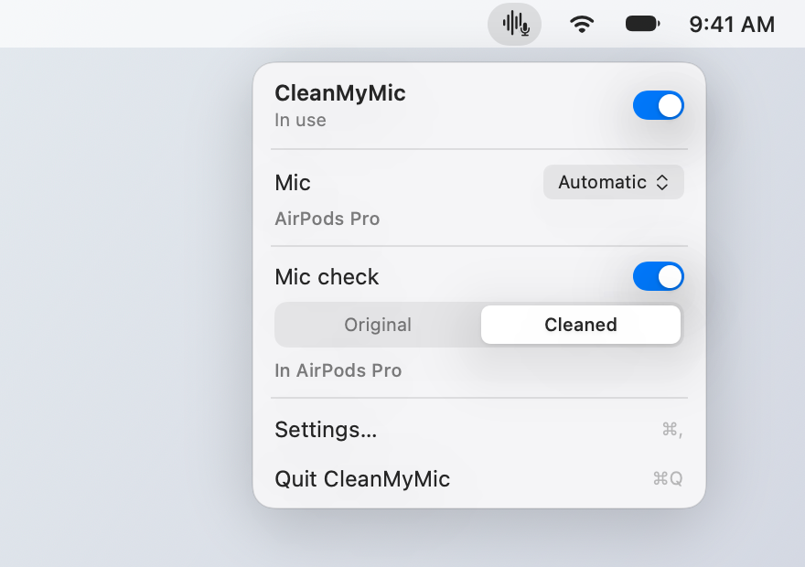

# CleanMyMic

A small macOS menu bar app that removes background noise, room echo and nearby voices from your microphone in Zoom, Meet, Teams, OBS and any other app. Everything runs locally on Apple Silicon - free, open source, no account, no cloud.

<p align="center">
  <picture>
    <source media="(prefers-color-scheme: dark)" srcset="docs/images/menu-dark.png">
    
  </picture>
</p>

**[Download CleanMyMic 0.2.0 (.pkg)](https://github.com/thisisvaze/cleanmymic/releases/latest/download/CleanMyMic-0.2.0-arm64.pkg)** · Apple Silicon (M1+), macOS 15+ · **[Hear samples in your browser](https://thisisvaze.github.io/cleanmymic/)**

## How it compares on Mac

| Tool | Price | Offline / no account | Works in every app | Nearby voices | Studio polish | Platform |
|---|---|---|---|---|---|---|
| **CleanMyMic** | Free (open source) | Yes | Yes (virtual mic) | Yes | Built-in (0 ms) | macOS Apple Silicon |
| Apple Voice Isolation | Free (built-in) | Yes | Per-app support | Partial | No | macOS |
| Krisp | $8-12/mo | Account required | Yes | Yes | Paid tiers | macOS / Windows |
| DeepFilterNet3 | Free (open source) | Yes | CLI / plugin | Limited | No | Cross-platform |
| NVIDIA Broadcast | Free (RTX GPU) | Yes | Yes | Yes | Yes | Windows only |

### Voice isolation benchmark

Scored across all 120 real calls (40 per set) from Krisp's public [Voice Isolation Benchmark](https://huggingface.co/datasets/Krisp-AI/VoiceIsolation-Benchmark-Dataset) using Whisper large-v3-turbo (mean per-clip WER capped at 100%; lower WER and higher background-voice suppression are better):

| Set (40 real calls each) | Raw mic | CleanMyMic Studio | Krisp VI 2.5 HD | DeepFilterNet3 |
|---|---:|---:|---:|---:|
| Work calls - Word Error Rate | 26.1% | **10.8%** | **10.3%** | 20.6% |
| Call center - Word Error Rate | 20.3% | **13.0%** | 14.8% | 19.8% |
| Phone calls - Word Error Rate | **3.7%** | 5.1% | 4.3% | 6.3% |
| Work calls - Background voice removed | - | **43.8 dB** | 30.9 dB | 14.8 dB |
| Call center - Background voice removed | - | **45.7 dB** | 29.4 dB | 18.6 dB |

Krisp VI 2.5 HD is Krisp's published benchmark output (not the current Krisp Mac app) and DeepFilterNet3 is stock 0.5.6. On already-filtered phone calls no processor beat raw input. CleanMyMic's background-voice suppression is measured on float output while published Krisp/DFN3 files are 16-bit PCM.

**[Listen to side-by-side room comparisons in your browser](https://thisisvaze.github.io/cleanmymic/#hear)** (time-aligned, loudness-matched, with a blind mode toggle).

## How light it is

Measured on an M5 Pro (macOS 27.2) running CleanMyMic Studio:

| | |
|---|---|
| Idle in menu bar | **27 MB** memory · **0.0% CPU** (physical mic fully released) |
| Active processing | **1.49 ms** per 10 ms frame (Core ML model + Studio Polish DSP, RTF 0.149) |
| Peak memory in a call | **66 MB** memory footprint |
| Algorithmic latency | **40 ms** (20 ms window + 20 ms lookahead; 0 ms extra for Studio Polish) |
| Size | **20 MB** app (incl. Core ML model) · **21.9 MB** signed & notarized installer |
| Code | **2,055 lines of Swift**, no Electron, no third-party Swift packages |

## What it does

- **Cleanup** - removes fans, typing, room echo, street noise and nearby speakers in real time using an on-device Core ML model, with a transparent preamp for quiet microphones and clock-drift resampling between physical and virtual devices
- **Studio polish** - optional 0 ms broadcast chain after cleanup: 80 Hz high-pass filter, mouth de-click, dynamic de-plosive, adaptive EQ, 2.8 kHz harshness taming, 6.5 kHz split-band de-esser, speech-gated leveler, fast vocal compressor and an always-on -1 dBTP peak limiter
- **Stays out of the way** - shows **Ready** when idle and only opens your mic while a call or recording app is actually using CleanMyMic (**In use**). Turning the top switch off passes original audio straight through without disconnecting your mic
- **Mic check** - hear **Original** vs **Cleaned** in your headphones before joining a call

## Install

Download [CleanMyMic-0.2.0-arm64.pkg](https://github.com/thisisvaze/cleanmymic/releases/latest/download/CleanMyMic-0.2.0-arm64.pkg), run the installer (installs the app, virtual microphone driver and Core ML model), restart your Mac so the virtual mic loads, then open **CleanMyMic** from Applications and pick **CleanMyMic** as the mic in Zoom, Meet, Teams or OBS.

Turn your call app's built-in noise suppression off or to Low so it doesn't double-process your voice.

### Build it yourself

Needs an Apple Silicon Mac (macOS 15+) and Xcode (Swift 6.2+). Model weights (`.mlpackage`) stay outside git - place your exported package at `models/CleanMyMicStudio.mlpackage`, then run:

```sh
git clone https://github.com/thisisvaze/cleanmymic.git
cd cleanmymic
./mac/bundle.sh install
./mac/driver/build.sh
./mac/driver/install.sh
```

`./mac/bundle.sh` on its own builds and signs `mac/build/CleanMyMic.app` (using your Developer ID or Apple Development certificate so mic permission sticks across rebuilds, or ad-hoc if none). See [INSTALL.md](INSTALL.md) for `.pkg` signing, notarization and uninstall steps.

### Exporting a model to Core ML

`model/` has the streaming PyTorch architectures and Core ML exporter (`model/export.py`). You only need Python 3.12+ and [uv](https://docs.astral.sh/uv/) if exporting your own `.pt` or DeepFilterNet3 `.ckpt.best` checkpoint:

```sh
uv sync --locked
uv run --locked model/export.py path/to/checkpoint.pt models/CleanMyMicStudio.mlpackage
```

## Tests

```sh
swift test --package-path mac
uv run --locked model/dfn3_studio.py
python3 mac/installer/verify.py
./mac/live.sh models/CleanMyMicStudio.mlpackage --check-bypass
```

## License

Original code is [MIT licensed](LICENSE). The virtual audio driver builds from [BlackHole](https://github.com/ExistentialAudio/BlackHole) (GPL-3.0) and `model/dfn3.py` adapts layers from [DeepFilterNet](https://github.com/Rikorose/DeepFilterNet) (MIT). See [THIRD_PARTY_NOTICES.md](THIRD_PARTY_NOTICES.md).
