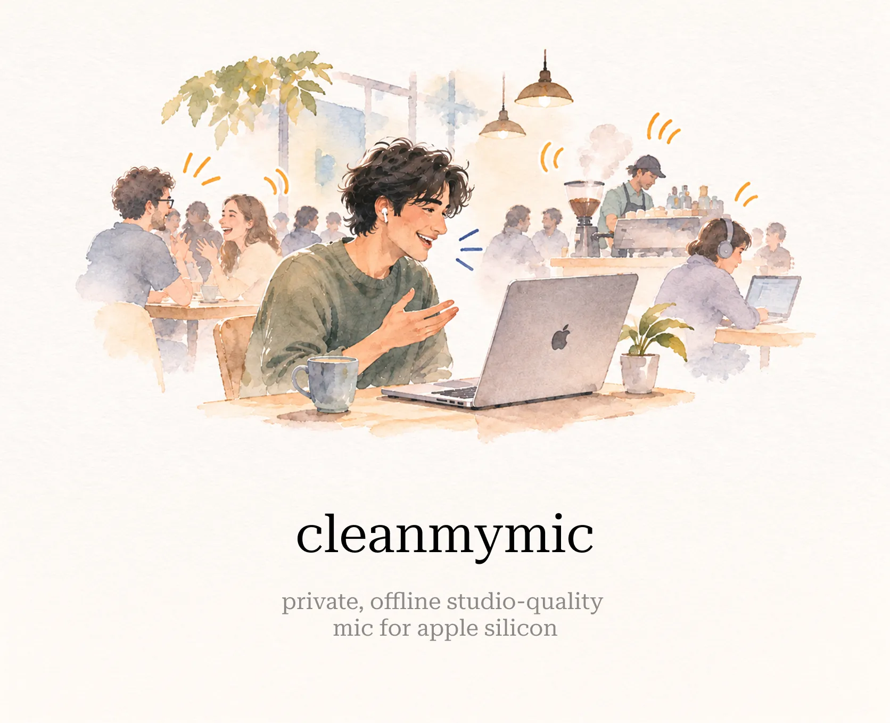

# CleanMyMic

A small macOS menu bar app that removes background noise and nearby voices from your microphone in Zoom, Meet, Teams, OBS and any other app. Everything runs locally on Apple Silicon - no account, no cloud.

## Cleanup

- Removes steady room noise, fans, keyboards, street noise and background voices in real time using an on-device Core ML model
- Works with any input device - MacBook mic, AirPods, USB and XLR interfaces
- Includes a transparent preamp for quiet microphones so soft rooms don't get swallowed, plus clock-drift resampling between your physical mic and virtual device
- Turning the main switch off passes your original voice straight through instead of muting or disconnecting the mic, so call apps keep using CleanMyMic either way

## Studio polish

Optional 0 ms broadcast mastering chain after neural cleanup (can be toggled in Settings):

- 80 Hz high-pass rumble filter, mouth de-click and dynamic de-plosive
- Adaptive voice EQ with subtle warmth, 2.8 kHz harshness taming and 6.5 kHz split-band de-essing
- Speech-gated broadcast leveler and fast vocal compressor so your volume stays even without pulling up room noise during pauses
- Always-on -1 dBTP peak limiter so your output never clips

## Menu bar & routing

- Stays idle in the menu bar (**Ready**) and only opens your physical microphone while another app is actually reading from the CleanMyMic virtual mic (**In use**)
- **Automatic** follows macOS's default physical mic and recovers if Bluetooth or USB devices disconnect; picking a mic manually pins it while available
- **Mic check** plays your mic to your headphones so you can flip between **Original** and **Cleaned** before a call
- System-wide default input routing is opt-in under **Settings > Cleanup**

## How light it is

Measured on an Apple Silicon Mac (M5 Pro, macOS 27.2) running the bundled FP32 Core ML Studio model:

| | |
|---|---|
| Model processing | ~1.5 ms per 10 ms frame |
| Algorithmic latency | 40 ms (20 ms window + 20 ms lookahead) |
| Studio polish DSP | 0 ms extra latency (pure Swift + Accelerate/vDSP) |
| Requirements | Apple Silicon (M1 or newer), macOS 15 or later |

## Build it yourself

Needs an Apple Silicon Mac with macOS 15+ and Xcode (Swift 6.2+). Model weights (`.mlpackage`) are kept out of git - place your exported Core ML package at `models/CleanMyMicStudio.mlpackage`, then run:

```sh
git clone https://github.com/thisisvaze/cleanmymic.git
cd cleanmymic
./mac/bundle.sh
./mac/driver/build.sh
./mac/driver/install.sh
open mac/build/CleanMyMic.app
```

`./mac/bundle.sh install` builds a release, signs it with your Developer ID or Apple Development certificate (ad-hoc if none) so microphone permission survives rebuilds, copies `CleanMyMic.app` to `/Applications` and opens it. See [INSTALL.md](INSTALL.md) for full setup, driver details and removal.

### Exporting a model to Core ML

`model/` contains the streaming PyTorch architectures and Core ML exporter (`model/export.py`). You only need Python 3.12+ and [uv](https://docs.astral.sh/uv/) if you are exporting your own `.pt` or DeepFilterNet3 `.ckpt.best` checkpoint:

```sh
uv sync --locked
uv run --locked model/export.py path/to/checkpoint.pt models/CleanMyMicStudio.mlpackage
```

The exporter verifies digital-silence and sparse-tone finiteness, checks frame-by-frame numerical agreement with PyTorch over 200 sequential frames, and benchmarks per-frame Core ML latency on your Mac.

## Tests

```sh
swift test --package-path mac
uv run --locked model/dfn3_studio.py
python3 mac/installer/verify.py
```

With a Core ML model available locally, you can also run the synthetic bypass/resume regression check (opens no mic):

```sh
./mac/live.sh models/CleanMyMicStudio.mlpackage --check-bypass
```

With the app installed and running, this times how long the virtual microphone stays silent after an app opens it (it opens your mic for a few seconds):

```sh
swift mac/micgap.swift
```

## Layout

- `mac/` - native SwiftUI menu bar app, Core Audio pipeline, vDSP Studio Polish chain, virtual driver build script and `.pkg` installer
- `model/` - streaming PyTorch model definitions (`dfn3.py`, `dfn3_studio.py`) and Core ML exporter (`export.py`)

## License

Original code is [MIT licensed](LICENSE). The virtual audio driver builds from [BlackHole](https://github.com/ExistentialAudio/BlackHole) (GPL-3.0) and `model/dfn3.py` adapts layers from [DeepFilterNet](https://github.com/Rikorose/DeepFilterNet) (MIT). See [THIRD_PARTY_NOTICES.md](THIRD_PARTY_NOTICES.md).
