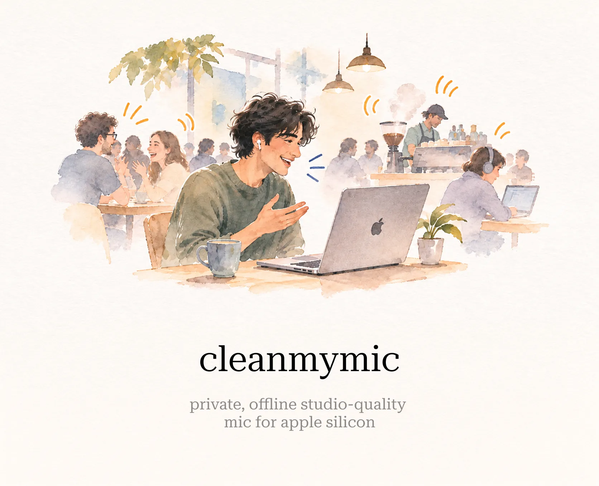

# CleanMyMic

Experimental microphone cleanup for Mac, processed locally with Core ML. Choose CleanMyMic in your call app, then switch it on for cleaned audio or off for your original voice. Your physical microphone is chosen automatically.

**v0.1.0-alpha.1 — Experimental preview.** One installer bundles the app, virtual microphone, and Base model. [Download from Releases →](https://github.com/thisisvaze/cleanmymic/releases/latest) · [Release notes →](docs/releases/v0.1.0-alpha.1.md)

**Known issue:** intermittent voice loss has been reported in a noisy café call using AirPods Pro and Google Meet, while background audio remained audible. The cause is unresolved. Use a physical microphone directly in your call app for important calls. [Setup and troubleshooting →](INSTALL.md#voice-cuts-out)

## Install

Requires an **Apple Silicon Mac with macOS 15 or later**.

### Ask your agent

Paste this into Codex, Claude Code, or another coding agent:

```text
Help me install CleanMyMic from https://github.com/thisisvaze/cleanmymic.
Read INSTALL.md first and check my Mac's compatibility and the release status.
Use the documented installation path. If a required installer or model is
unavailable, tell me exactly what is missing before making system changes.
```

## Hear it

Three 10-second clips from real office, call-center, and car recordings with strong background noise; no noise was added. Play the original, CleanMyMic Base, and Krisp or DeepFilterNet3 side by side at the same volume:

**[▶ Listen in your browser](https://thisisvaze.github.io/cleanmymic/audio/)**

Audio © Krisp Technologies · CC BY-NC 4.0 · [Sources and method →](docs/audio/README.md)

## Lightweight

| | CleanMyMic Base |
|---|---|
| Processing per 10 ms of audio | **0.21 ms** |
| Model latency | **40 ms** (20 ms window + 20 ms look-ahead) |
| CPU while in a call | **~3%** of one core |
| Memory | **~43 MB** |
| Size | **8.4 MB** model · 13.6 MB installer with app and virtual mic |

Measured on an M5 Pro with macOS 27.2. CPU excludes any Neural Engine work; latency excludes audio-device and call-app buffering. [Method →](docs/benchmarks.md#resource-use)

## Benchmarks

Word error rate on Krisp's real-world [Voice Isolation Benchmark](https://huggingface.co/datasets/Krisp-AI/VoiceIsolation-Benchmark-Dataset): mean per-clip WER from Whisper large-v3-turbo, 40 clips per set, lower is better. Measured October 31, 2026 for CleanMyMic Base.

| Set | Raw input | CleanMyMic Base | Krisp VI 2.5 HD | DeepFilterNet3 |
|---|---:|---:|---:|---:|
| Work calls | 26.1% | **9.7%** | 10.3% | 20.6% |
| Call center | 20.3% | **13.1%** | 14.8% | 19.8% |
| Phone calls | **3.8%** | 4.1% | 4.3% | 6.3% |

Best in each row is bold; on phone calls no processor beat the raw input. Krisp is its published benchmark output, not the current Krisp app; DeepFilterNet3 is stock 0.5.6. The gaps to Krisp are small and uncertain (few speakers per set), so this is not a ranking. Base removes background voices well on work and call-center calls (about 30 dB) but poorly on phone calls, and it costs some words on clean speech (6.5% vs 3.1% WER on DAPS). [Full results, uncertainty, and method →](docs/benchmarks.md)

## Code

[`mac/`](mac/) contains the app and driver build scripts. [`train/`](train/) contains the model and Core ML export code. [`eval/`](eval/) contains recording and comparison tools.

[Build, setup, and first use →](INSTALL.md) · [Contributing and local checks →](CONTRIBUTING.md) · [Release readiness →](docs/releasing.md#readiness)

## License

Original code is [MIT licensed](LICENSE). See [third-party notices](THIRD_PARTY_NOTICES.md) for dependencies and audio credits.
